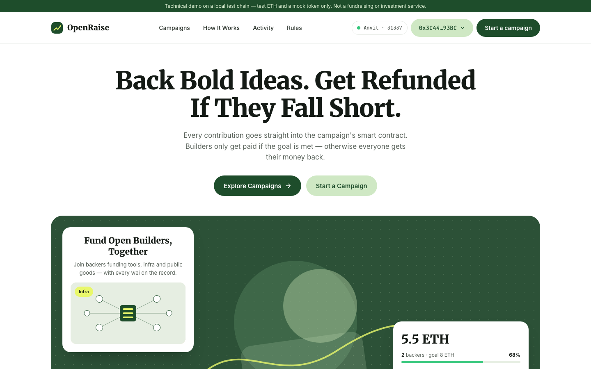
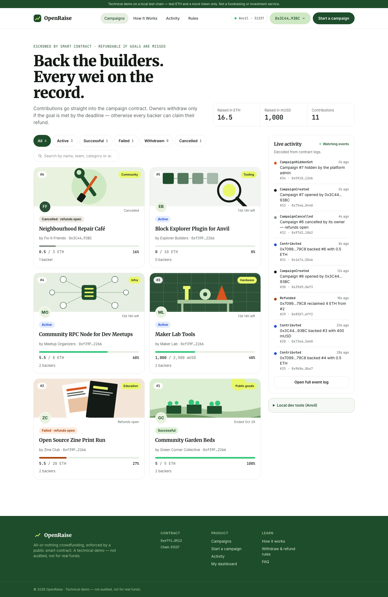
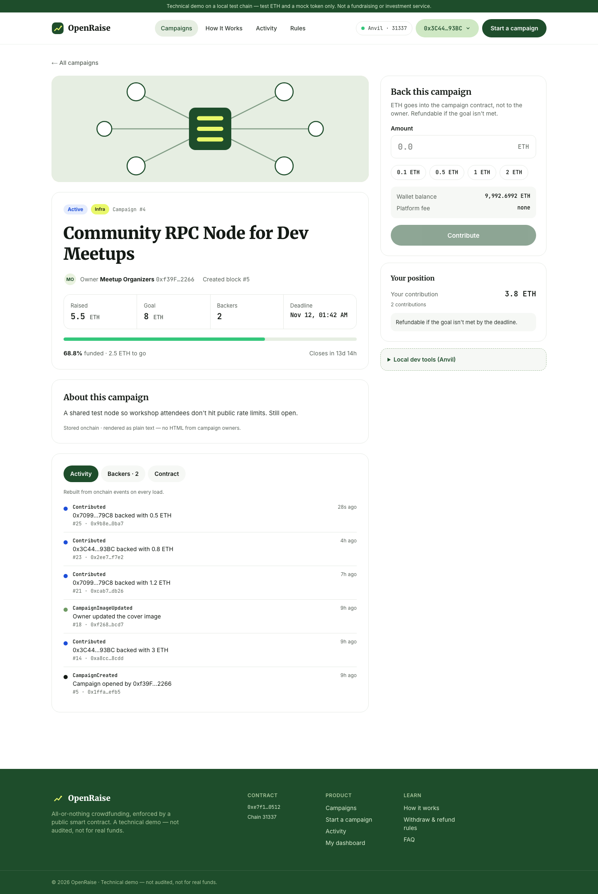
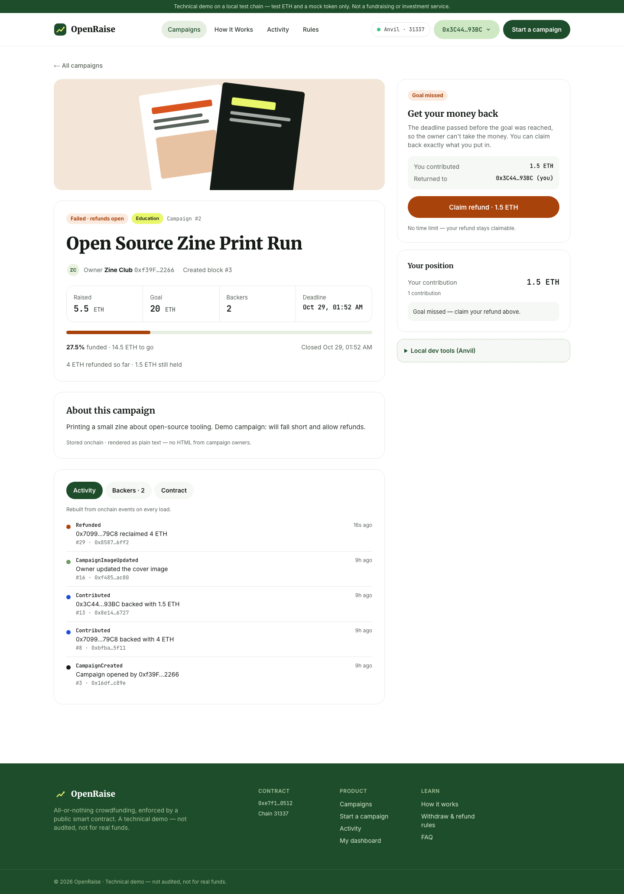
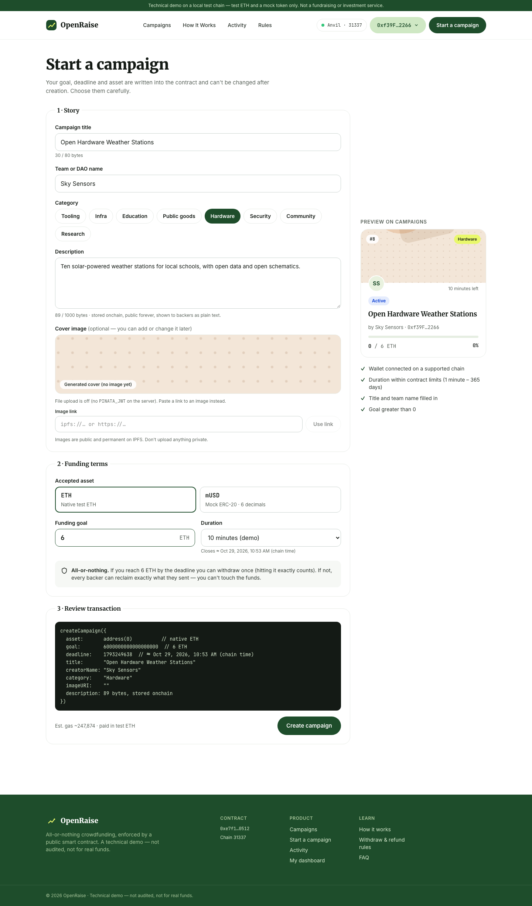
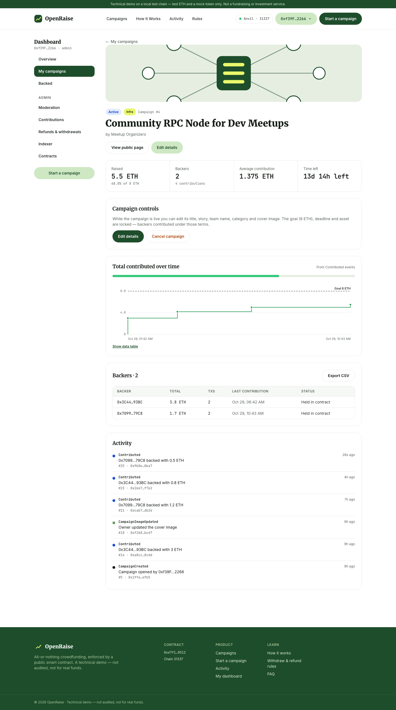
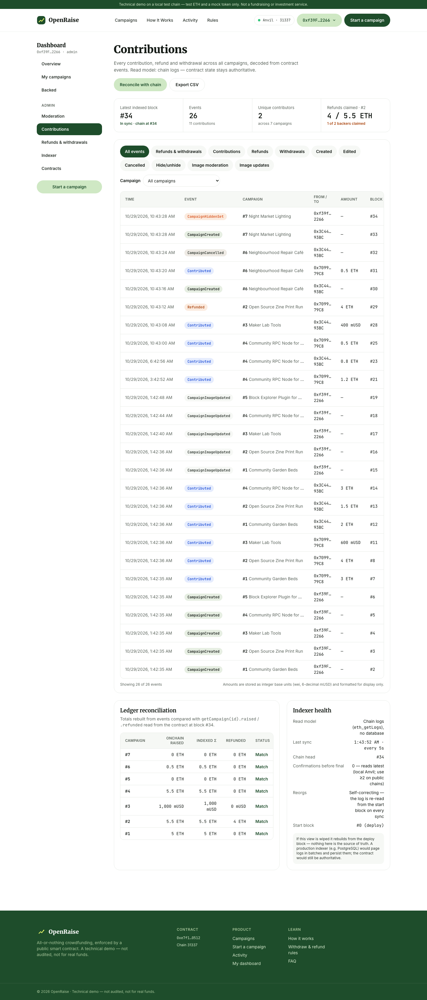
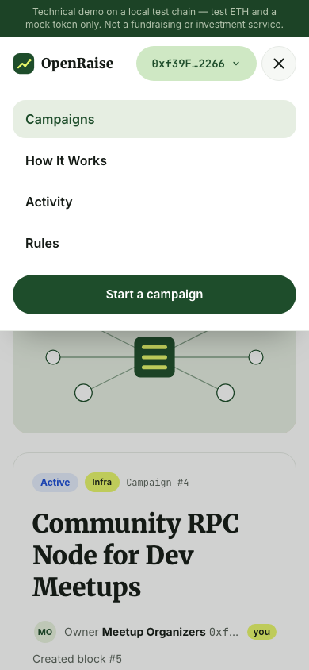

# OpenRaise

An **all-or-nothing crowdfunding dApp** with the rules enforced by a smart contract. Each campaign sets a goal and a
deadline. If the goal is met in time, the owner withdraws **once**. If it isn't, or the campaign is cancelled, every
backer reclaims **exactly** what they put in. No one, including the platform admin, can move the money any other way.

> ⚠️ **Local chain and testnets only.** This portfolio prototype runs on a local Anvil chain (`31337`) by default. Its
> test ETH and mock token have **no monetary value**, the contract is **not audited**, and the deploy script refuses
> mainnet. It is not a fundraising or investment service. Never import a real seed phrase or private key.



**Stack:** Solidity 0.8.28 · Foundry · OpenZeppelin 5.1 · Next.js 16 · React 19 · wagmi 3 · viem 2 · TanStack Query ·
Tailwind 4 · IPFS (Pinata) · Vitest · Playwright · GitHub Actions

## Screenshots

| | |
|---|---|
| **Explore campaigns**<br>Status tabs with counts, search by title, team, category or address, cover images, and a live feed of onchain events. | [](docs/images/explore.png) |
| **Campaign page** (backer)<br>Progress, deadline, backers and story. The right-hand panel shows exactly what *this* wallet can do: contribute, withdraw, claim a refund, or why not. | [](docs/images/campaign.png) |
| **Refunds**<br>When a campaign fails or is cancelled, backers see their exact refundable amount and claim it themselves. | [](docs/images/campaign-refund.png) |
| **Start a campaign**<br>Validation as you type, an optional IPFS cover image, a live preview card, a preview of the exact contract call, and a gas estimate. | [](docs/images/create.png) |
| **Owner: manage a campaign**<br>KPIs, a contributions-over-time chart against the goal, a backers table with CSV export, and Edit / Cancel / Withdraw. | [](docs/images/dashboard-manage.png) |
| **Admin: contributions & indexer**<br>Every event with filters and CSV export, refund tracking, a per-campaign ledger reconciliation against contract state, and indexer health. | [](docs/images/admin-contributions.png) |
| **Mobile**<br>Every page works down to 320px, with a hamburger menu. | [](docs/images/mobile-menu.png) |

**Every page, explained with a screenshot:** see the **[Page guide](docs/pages.md)**.
Screenshots come from a local Anvil chain with the demo data. Regenerate them with `make screenshots`.

## Features

- **Smart contract** ([`contracts/src/OpenRaise.sol`](contracts/src/OpenRaise.sol)): one registry for all campaigns, in
  test ETH or an allowlisted ERC-20. It covers create, contribute, withdraw, refund, edit, cancel, cover images and
  moderation. Reentrancy is guarded and every rule is checked onchain. **100% line and branch coverage**, with fuzz and
  invariant tests.
- **Three roles, one app:**
  - **backers** browse, contribute and claim refunds;
  - **campaign owners** create, edit, cancel, withdraw and track analytics;
  - **the admin** moderates (hide, remove image, cancel to refund) and runs the ops dashboard.
- **Wallet flows:**
  - One-click Anvil dev accounts locally (no keys in the browser), or any browser wallet.
  - Every transaction step is visible: checking → confirm in wallet → pending → confirmed / reverted / failed, with
    plain-language errors and a retry.
  - Pending transactions resume after a page reload.
- **Event read model:** activity, backer lists, the dashboard and reconciliation are rebuilt from contract events on
  every load. The contract stays the source of truth, and the admin reconciliation checks one against the other.
- **Cover images on IPFS:** uploaded through a server route to Pinata, with the key never in the browser. Only the
  `ipfs://` link is stored onchain. Files are type-checked by content, and the admin can remove and lock an image.
- **Saved local chain:** `make anvil` keeps your campaigns across restarts.
- **Safety by default:**
  - mainnet is refused in both the deploy script and the app;
  - campaign text and image links are treated as untrusted (rendered as plain text, only safe image links);
  - token approvals are for the exact amount.

## Prerequisites

| Tool | Tested with |
|---|---|
| Node.js | 22 LTS |
| npm | 10 |
| Foundry (`forge`, `anvil`, `cast`) | 1.8.5: `curl -L https://foundry.paradigm.xyz \| bash && foundryup` |
| GNU Make | the one shipped with macOS / Linux |
| Git | any |

No database is needed. Pinata is optional and only used for image uploads.

## Quick start

```bash
git clone https://github.com/robiul-shagor/OpenRaise.git openraise && cd openraise
make install          # Foundry libraries (forge-std, OpenZeppelin) + web dependencies
```

Then use two terminals:

```bash
# 1. Local chain (saved to contracts/.anvil-state.json, reloaded next time)
make anvil

# 2. Contracts + demo data (only on a brand-new chain), then the web app
make up               # http://localhost:3000
```

Open http://localhost:3000, click **Connect wallet** and pick an **Anvil #n** account:
- **#0:** the owner of the demo campaigns, and the platform admin;
- **#1 and #2:** backers.

These accounts need no browser extension, because Anvil signs for its unlocked dev accounts.

## Demo walkthrough

The seed creates five campaigns. All belong to Anvil #0.

| # | Campaign | Asset | Goal | Seeded | Ends | Path |
|---|---|---|---|---|---|---|
| 1 | Community Garden Beds | ETH | 5 | 5 | 10 min | **Success → withdraw** |
| 2 | Open Source Zine Print Run | ETH | 20 | 5.5 | 10 min | **Failure → refunds** |
| 3 | Maker Lab Tools | mUSD | 2,500 | 600 | 14 days | Active, ERC-20 |
| 4 | Community RPC Node for Dev Meetups | ETH | 8 | 3 | 14 days | Active |
| 5 | Block Explorer Plugin for Anvil | ETH | 10 | 0 | 14 days | Active, no backers yet |

1. **Back a campaign.** Connect *Anvil #2* → open #4 → enter `0.5` → **Contribute**. Watch it go from checking to
   confirm to pending to confirmed.
2. **Let time pass.** Open *Local dev tools* (any campaign page) → **+1 hour**. #1 becomes **Successful** and #2
   becomes **Failed**.
3. **Withdraw as the owner.** Connect *Anvil #0* → click your address → **My dashboard**. "Needs your action" shows
   **Withdraw 5 ETH** → withdraw.
4. **Claim a refund as a backer.** Connect *Anvil #1* → **My dashboard → Backed** → **Claim refund** on #2. Claiming
   twice is refused by the contract.
5. **Edit or cancel as the owner.** *My campaigns* → **Edit** on #4 (the goal and deadline are shown locked), or
   **Cancel campaign**, which refunds every backer immediately.
6. **ERC-20.** Connect *Anvil #2* → open #3 → **Get 10,000 mUSD** (dev tools) → approve → contribute.
7. **Admin.** As *Anvil #0*, click your address → **Admin**: hide a campaign, remove an image, open
   **Contributions** and check that every campaign reconciles as **Match**.

### Using a browser wallet instead

Use a **development-only** browser profile and add a network with RPC `http://127.0.0.1:8545` and chain ID `31337`.
Import one of the disposable private keys printed by your local `anvil`. Never use those keys on a public network.

## Cover images (IPFS)

Images can't be stored onchain economically, so the contract stores a **link** (`imageURI`), and the file lives on
IPFS.

1. Create a free account at [Pinata](https://app.pinata.cloud), make an API key and copy its **JWT**.
2. Put it in `web/.env.local` as `PINATA_JWT=…`. It's server-only, so never prefix it with `NEXT_PUBLIC_`.
3. Restart the app. Create and Edit now show **Upload image**.

Without a key, upload is switched off and creators paste an `ipfs://` or `https://` link instead.

**Safeguards:**
- 3 MB maximum.
- PNG, JPEG, WebP or GIF only, checked by the file's real content. SVG is refused.
- The uploader's filename is never sent to Pinata.
- 10 uploads per IP every 10 minutes.
- Only safe links are rendered, with `no-referrer`, and a broken image falls back to a generated cover.

The owner can change the image **at any time**, even after the campaign ends. The admin can remove and lock it.

## Your campaigns are saved

Anvil normally keeps the chain in memory. `make anvil` saves it to `contracts/.anvil-state.json` (every 10 seconds
and on exit) and reloads it on the next start, so campaigns, contributions and history survive restarts.
`make up` only deploys and seeds when the contract isn't on the chain yet.

| Command | What it does |
|---|---|
| `make anvil-reset` | Delete the saved chain (stop `make anvil` first). The next `make anvil` + `make up` starts fresh. |
| `make anvil-export` / `make anvil-import` | Snapshot a running chain to a file, and load that snapshot into a running chain |

## Commands

| Command | What it does |
|---|---|
| `make install` | Install Foundry libraries and web dependencies |
| `make anvil` | Start the local chain (saved state) |
| `make up` | Deploy + seed if needed, then start the dev server |
| `make dev` | Start the Next.js dev server only |
| `make deploy` / `make seed` / `make sync` | Force a new deployment, add demo data, or copy ABIs + addresses into `web/src/generated`. On a saved chain, `make deploy` creates a second copy, so prefer `make up`. |
| `make test-contracts` | `forge test`: unit, fuzz and invariant suites |
| `make test-web` | ESLint, `tsc`, Vitest |
| `make e2e` | Playwright journeys on their own chain (:8555) and production build (:3100). Safe to run while `make dev` is up. |
| `make screenshots` | Regenerate `docs/images/*.png` from a fresh demo chain (:8600 / :3200) |
| `make test` | Contracts + web + e2e |

## Troubleshooting

- **Banner: "OpenRaise isn't deployed on this chain".** Anvil was restarted without saved state, or the state was
  reset. Run `make up`, or `make deploy seed` if the app is already running.
- **`make anvil`: "Address already in use".** Another Anvil is on port 8545. Check with
  `lsof -iTCP:8545 -sTCP:LISTEN` and stop it.
- **RPC error "invalid block range".** The app's synced config points at a deployment from a different chain. Run
  `make up` (or `make sync`) and refresh.
- **`make: anvil: No such file or directory`.** Foundry isn't installed in `~/.foundry/bin`. Run `foundryup`.
- **The page looks stale after code changes.** Restart `make dev`.
- **Port 3000 in use.** `cd web && npx next dev -p 3001`.

## Rules (summary)

- Contributions are accepted while `block.timestamp < deadline`. At exactly the deadline, the campaign has ended.
- The goal is **inclusive**: `raised >= goal` is a success.
- The **owner** withdraws once, only after the deadline, and only if the campaign succeeded.
- **Backers** refund once, for exactly their recorded contribution, if the campaign failed or was cancelled.
- The **owner** may edit title, story, team name and category while Active. The goal, deadline and asset never
  change. The cover image can be changed at any time.
- **Cancel** (the onchain "delete"): the owner or the admin, while Active. Backers are refunded in full.
- The **admin** can also hide campaigns and remove or lock images. It can never withdraw or redirect funds.

The full state machine, edge cases and permission table are on the in-app **Rules** page and in
[docs/architecture.md](docs/architecture.md).

## Contract addresses

| Network | OpenRaise | MockERC20 (mUSD) |
|---|---|---|
| Anvil 31337 (fresh chain, deployer = account #0) | `0xe7f1725E7734CE288F8367e1Bb143E90bb3F0512` | `0x5FbDB2315678afecb367f032d93F642f64180aa3` |
| Sepolia | not deployed | — |

These addresses are deterministic: a fresh Anvil plus the first deploy always produces them. For a testnet, deploy
with a **disposable** account (`forge script script/Deploy.s.sol --rpc-url $SEPOLIA_RPC --account <keystore> --broadcast`)
and set the `NEXT_PUBLIC_TESTNET_*` variables from [web/.env.example](web/.env.example).

## Test results

Measured locally on 2026-10-29:

```
contracts  forge test           66 unit/fuzz passed · invariant suite passed (256 runs × 64 calls, 0 reverts,
                                incl. random owner/admin cancels and edits)
           forge coverage       OpenRaise.sol: 100% lines (140/140) · 100% branches (44/44) · 100% funcs (21/21)
web        vitest               38 passed (format, eligibility, errors, backer stats, reconcile, image URL safety,
                                upload validation, /api/upload with mocked Pinata, components)
           playwright           11 passed: success→withdraw (via dashboard) · failure→refund (incl. reload) ·
                                ERC-20 approve→contribute · activity reconcile + filters · explore search/category ·
                                owner edit (terms stay locked) · owner cancel→backer refund · admin hide + cancel ·
                                cover image by link → admin remove + lock · image change on a failed campaign · admin ops pages
           eslint · tsc · next build   clean
```

## Repository layout

```text
contracts/            Foundry project
  src/                OpenRaise.sol (campaign registry) · MockERC20.sol (valueless test token with a faucet)
  test/               unit + fuzz tests, invariant/ (handler-based accounting invariants)
  script/             Deploy.s.sol (refuses mainnet) · Seed.s.sol (demo campaigns, Anvil only)
  deployments/        <chainId>.json written by the deploy script
web/                  Next.js app
  src/app/            pages: home, campaigns, campaign detail, create, activity, rules,
                      dashboard/ (overview, my campaigns → manage/edit, backed, admin/…), api/upload
  src/components/     UI building blocks (cards, covers, chart, event feed, wallet, tx notices)
  src/lib/            wagmi config, contract reads, transaction lifecycle, formatting, image + upload safety
  e2e/                Playwright user journeys
  e2e-docs/           screenshot generator for docs/images
docs/                 page guide, architecture, security notes, images/
.github/workflows/    CI: forge fmt/build/test · web lint/typecheck/test/build · Playwright e2e
```

## Documentation

- **[Page guide](docs/pages.md):** every page, with a screenshot and what you can do there
- [Architecture & state machine](docs/architecture.md) · [Security notes](docs/security-notes.md)

## Limitations

- **Not audited.** Slither and Aderyn have not been run; `forge lint` findings are reviewed in the security notes.
- **The admin is a trusted moderator.** It can cancel any Active campaign (funds go back to backers, never to the
  admin). A real deployment should use a multisig.
- **Payment edge cases.** A campaign owner whose address rejects ETH can't withdraw. Fee-on-transfer and rebasing
  tokens aren't supported.
- **No database indexer.** The read model is chain logs, which is fine at demo scale.

See [docs/security-notes.md](docs/security-notes.md#known-limitations).

## Disclaimer

A self-directed portfolio prototype. No independent audit or formal verification has been performed. Test tokens
have no value. Deploy only to local or test networks, and never use it with real funds.
