# Architecture & state machine

## Campaign state machine

Status is **derived** on every read from `(withdrawn, block.timestamp, deadline, raised, goal)`. It is never stored, so it can't drift from the rules.

```mermaid
stateDiagram-v2
    [*] --> Active: createCampaign()
    Active --> Active: contribute()  [now < deadline]
    Active --> Successful: time passes  [now ≥ deadline ∧ raised ≥ goal]
    Active --> Failed: time passes  [now ≥ deadline ∧ raised < goal]
    Active --> Active: updateCampaign()  [owner; text fields only]
    Active --> Cancelled: cancelCampaign()  [owner or admin]
    Successful --> Withdrawn: withdraw()  [msg.sender = owner, once]
    Failed --> Failed: refund()  [contributionOf[sender] > 0, once per backer]
    Cancelled --> Cancelled: refund()  [contributionOf[sender] > 0, once per backer]
    Withdrawn --> [*]
```



| Status | contribute | withdraw | refund | update | cancel |
|---|---|---|---|---|---|
| Active | ✅ any account | ❌ | ❌ | ✅ owner | ✅ owner or admin |
| Successful | ❌ | ✅ owner only, once | ❌ | ❌ | ❌ |
| Failed | ❌ | ❌ | ✅ each backer, own amount, once | ❌ | ❌ |
| Withdrawn | ❌ | ❌ | ❌ | ❌ | ❌ |
| Cancelled | ❌ | ❌ | ✅ each backer, own amount, once | ❌ | ❌ |

`hidden` is a separate admin-set display flag. It isn't a status and changes none of the rules above.

**Images:** `imageURI` holds an `ipfs://` or `https://` link (or nothing), checked onchain and limited to 256 bytes. The owner sets it on create or edit, and can change it at any time, in any status, with `updateImage` (image only; text stays frozen after the end). The admin's `setImageLocked(id, true)` clears it and blocks the owner from setting another; `false` lifts the block. Files are uploaded by `web/src/app/api/upload/route.ts` to Pinata (public IPFS), so the Pinata key never reaches the browser.

## Boundary rules

| Rule | Decision | Test |
|---|---|---|
| Deadline | Contributions accepted iff `block.timestamp < deadline`. At `== deadline` the campaign has ended. | `test_contribute_oneSecondBeforeDeadline`, `test_contribute_atDeadlineReverts` |
| Goal | **Inclusive**: `raised >= goal` succeeds. | `test_goal_exactIsSuccessful`, `test_goal_oneWeiShortIsFailed` |
| Over-funding | Allowed while Active; owner withdraws the full `raised`. | `test_contribute_overGoalAllowedWhileActive` |
| Early withdrawal | Not allowed, even after the goal is hit. All-or-nothing is settled only at the deadline. | `test_withdraw_beforeDeadlineReverts` |
| Duration | 1 minute ≤ `deadline - now` ≤ 365 days | `test_create_*Deadline*` |
| Zero campaign | 0 contributions → Failed (nothing to refund) | `test_noContributionsIsFailed` |

## Contract layout

A single `OpenRaise` registry stores all campaigns in a mapping (`id → Campaign`) instead of deploying one contract per campaign. That keeps creation cheap and gives the frontend one address and one event stream.

- **Campaign fields**: `createCampaign(CampaignParams)` takes the asset, goal, deadline, title (1–80 bytes), description (≤1000 bytes), creator/team name (1–48 bytes) and category (1–24 bytes). None of these can change after creation. The text fields are untrusted display data, and the frontend offers a fixed list of categories. They are passed as one struct to keep the function under the EVM stack limit.

- **Accounting**: `raised` is a historical total and never decreases. `refunded` counts refunds paid. Funds still held for a Failed campaign are `raised - refunded`. Each backer's claim is `contributionOf[id][backer]`, which is set to zero on refund.
- **No unbounded loops** in state-changing code. Refunds are pull-based (each backer claims their own), so there's no loop over backers. `getCampaigns(offset, limit)` is a view with a caller-chosen bound, meant for offchain reads.
- **Assets**: `address(0)` is native ETH, which is always allowed. An ERC-20 has to be allowlisted by the registry owner first. That owner can't touch campaign funds, pause anything, or change existing campaigns.
- **External calls**: these are `safeTransferFrom` in `contribute` (after the effects) and the payout in `withdraw` and `refund` (after the effects). All three are `nonReentrant`.

## Frontend data flow

```
Wallet (injected / Anvil dev)                  Anvil / testnet
        │  simulate → sign → receipt                   ▲
        ▼                                              │ eth_call / getLogs
 useSendTx (lib/tx.tsx) ──── persists pending hashes ──┤
        │                    (localStorage, resumed    │
        │                     after refresh)           │
        ▼                                              │
 TanStack Query cache ◄── useCampaign / useCampaigns / useActivity (lib/hooks.ts)
```

- **Contract state is authoritative.** The UI shows the `status` returned by `getCampaign`. It never computes status itself for anything that gates an action. `eligibility()` only decides which button to show, and the contract enforces the rules again.
- **Simulation before signing.** Each write runs `simulateContract` first, so most reverts show up as readable messages (`lib/errors.ts`) before the wallet prompt appears.
- **Transaction phases**: simulating → signing → pending (with the hash) → confirmed, reverted or failed. Failed and reverted states have a retry button.
- **Refresh recovery**: pending hashes are kept in `localStorage` and awaited again after a reload. The activity timeline is rebuilt from `getLogs`, so the history is never stored only on the client.
- **Chain time**: countdowns use the latest block timestamp, not the browser clock, so they follow Anvil time travel.
- **Untrusted content**: titles and descriptions are rendered only as escaped React text (no `dangerouslySetInnerHTML`, no auto-linking). Length limits are enforced onchain.
- **Amounts**: values are `bigint` base units throughout. Conversion goes through `parseUnits`/`formatUnits` using the token's `decimals()` read from the chain. Floating point is never used.

- **One event read model**: `useEvents()` reads all four event types once. The campaign timelines, backer counts and Backers table, the homepage totals and the Activity dashboard are all derived from it.
- **Reconcile**: the dashboard recomputes `Σ Contributed`, `Σ Refunded` and whether a `Withdrawn` event exists for each campaign, then compares them with the contract's `raised`, `refunded` and `status`, and reports any mismatch.

The optional PostgreSQL indexer from the plan is **not built**. At demo scale, direct `getLogs` is enough, and it keeps the chain as the only source of truth.
