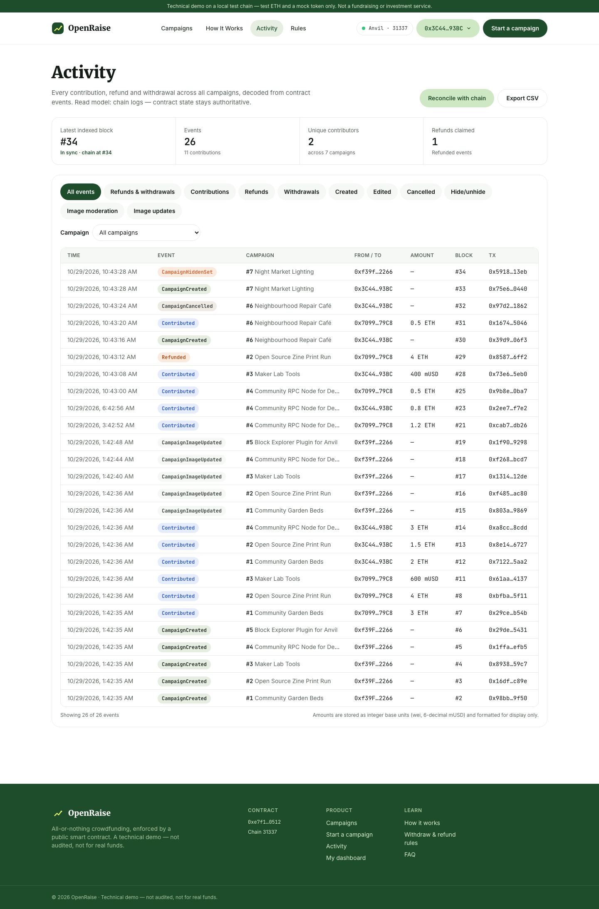
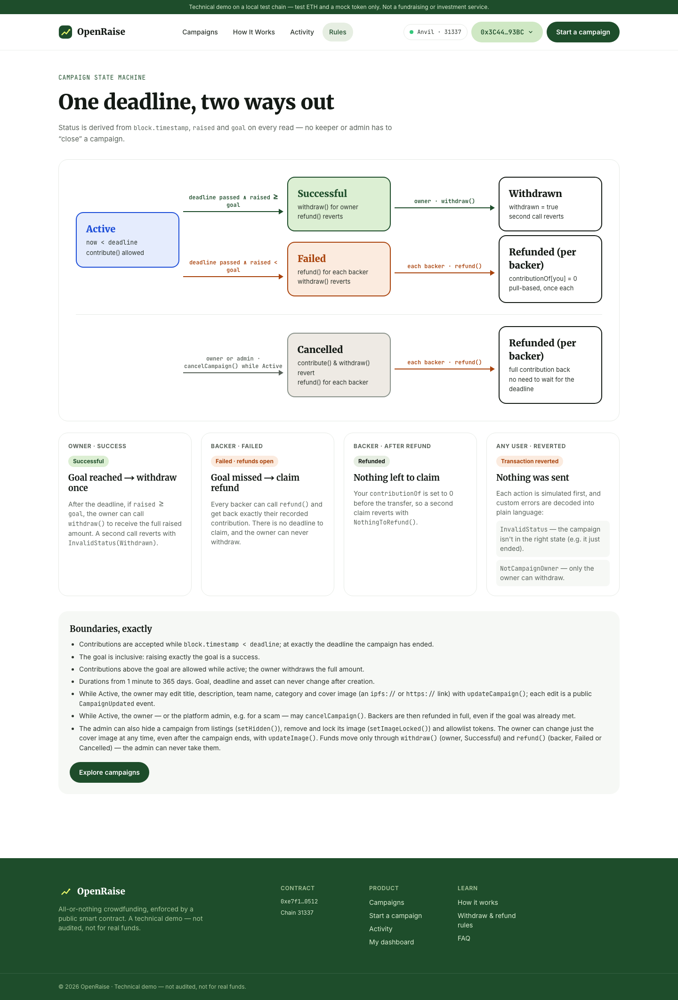
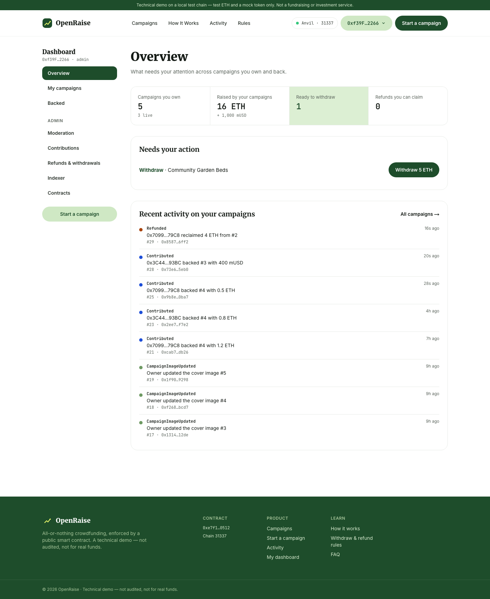
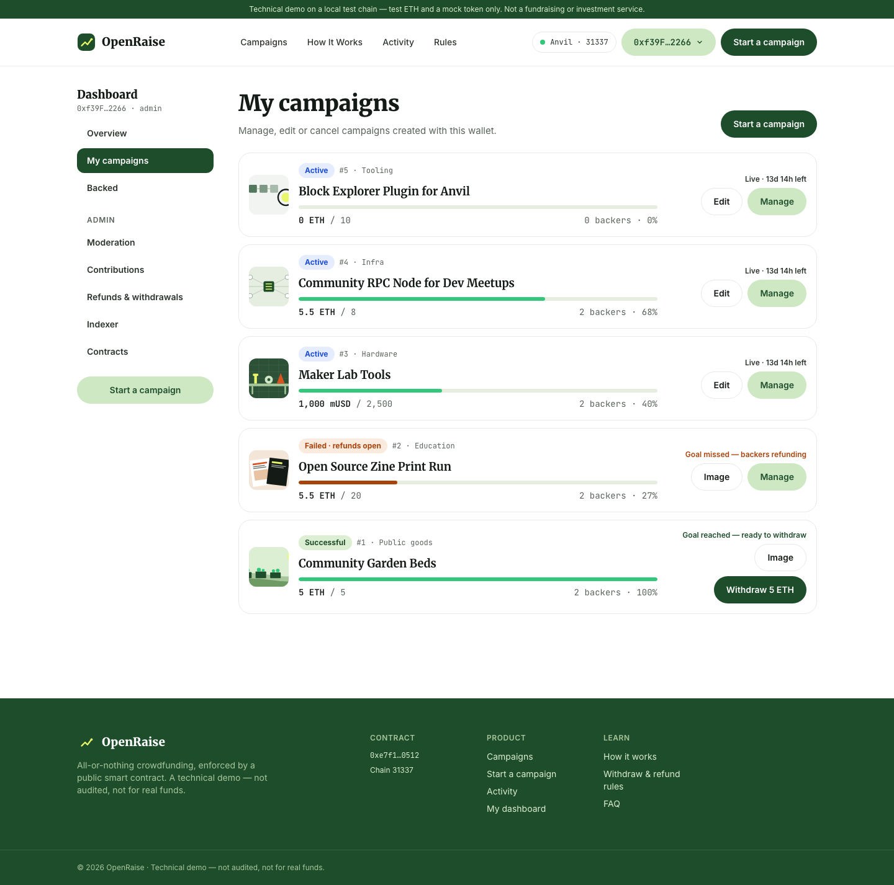
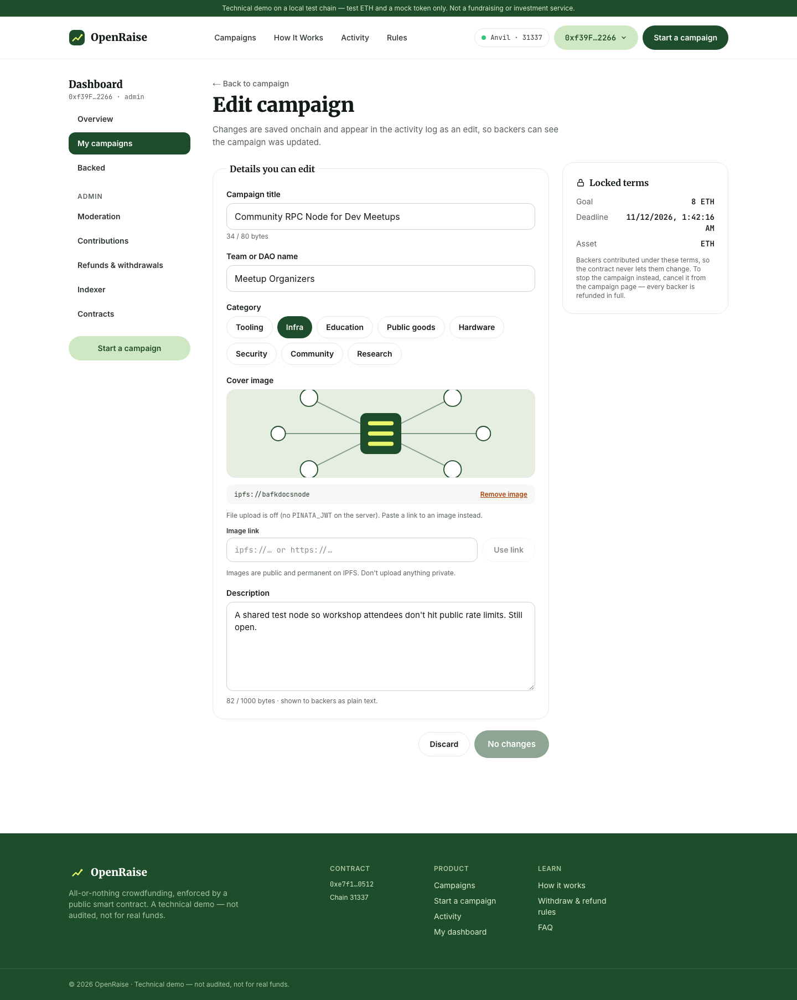
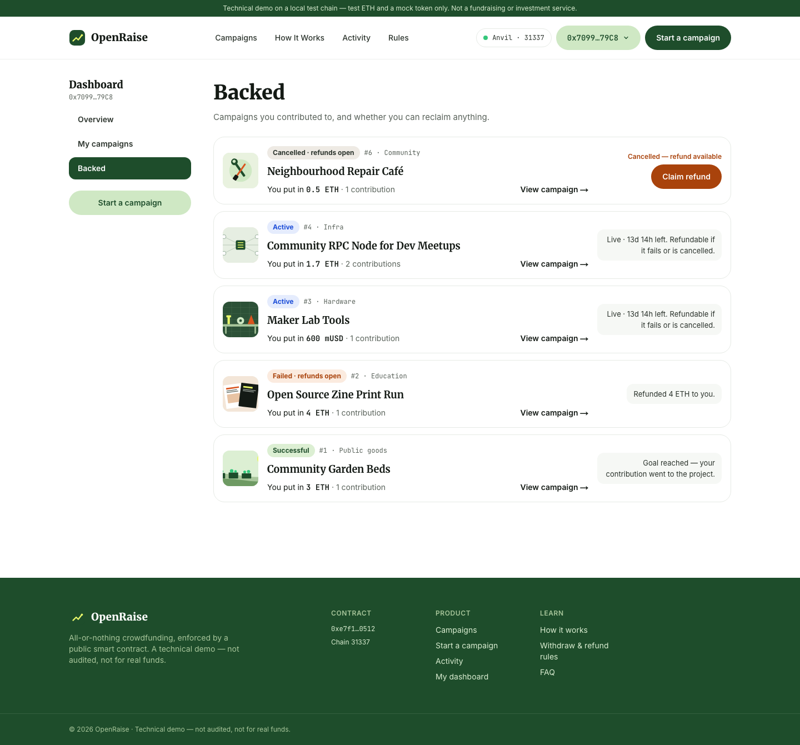
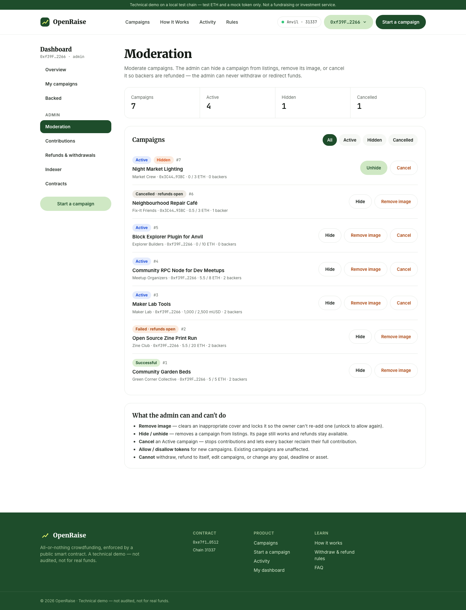
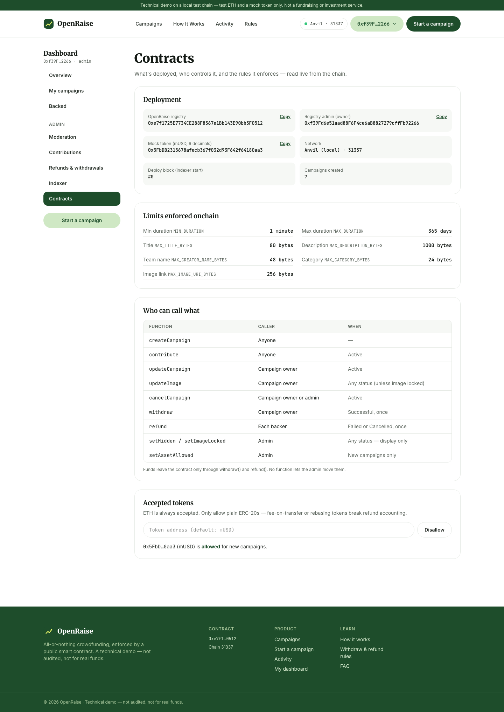
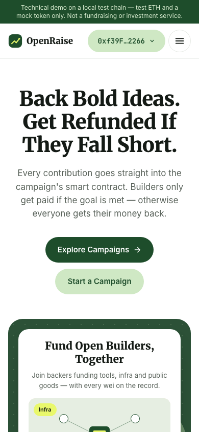
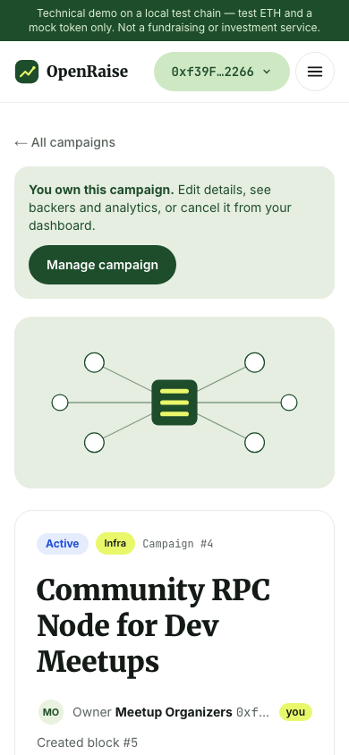

# Page guide

A tour of every page in OpenRaise: what it shows, who it's for, what you can do there, and what happens onchain.
Click any screenshot to open it full size.

The screenshots come from a local Anvil chain with the demo data, generated by `make screenshots`. That command
seeds the five standard campaigns, then adds:
- a few extra contributions over several hours (for the chart);
- a partial refund;
- one cancelled campaign (#6) and one hidden campaign (#7);
- cover images.

The images are local placeholders, not real IPFS uploads.

**Roles used below:**
- **Visitor:** no wallet connected.
- **Backer:** contributes to campaigns (Anvil #1 and #2 in the demo).
- **Owner:** created the campaign (Anvil #0 for campaigns #1–#5).
- **Admin:** the wallet that deployed the registry (Anvil #0 locally).

## Contents

- **Public pages:** [Home](#home) · [Campaigns](#campaigns-explore) · [Campaign page](#campaign-page) ·
  [Refunds](#refunds-on-the-campaign-page) · [Activity](#activity) · [Rules](#rules)
- **Owners:** [Start a campaign](#start-a-campaign) · [Dashboard overview](#dashboard--overview) ·
  [My campaigns](#dashboard--my-campaigns) · [Manage a campaign](#manage-a-campaign) · [Edit](#edit-a-campaign)
- **Backers:** [Backed](#dashboard--backed)
- **Admin:** [Moderation](#admin--moderation) · [Contributions & indexer](#admin--contributions--indexer) ·
  [Contracts](#admin--contracts)
- [Mobile](#mobile) · [Things on every page](#things-on-every-page)

---

## Public pages

### Home

`/` · everyone

The landing page. From top to bottom:

- **Hero** with the product's promise and two calls to action: *Explore Campaigns* and *Start a Campaign*.
- **Featured campaign**: the live campaign closest to its goal, with raised amount, backers, progress, and *Back now*
  / *View campaign*. A backer count sits underneath.
- **How it works**: four tabs, one per contract function (`createCampaign`, `contribute`, `withdraw`, `refund`), each
  with a short explanation and a link.
- **Discover campaigns**: a three-at-a-time carousel of live campaigns.
- **Running totals** across all campaigns: contributions, ETH raised and mUSD raised.
- **Trust section**: why nobody has to trust the platform.
- **FAQ** and footer, including the live contract address.

Hidden and cancelled campaigns never appear here. [Full-page screenshot](images/home-full.png).

### Campaigns (Explore)

`/campaigns` · everyone

- **Platform totals** at the top: raised in ETH, raised in mUSD, and number of contributions.
- **Status tabs** with live counts: All, Active, Successful, Failed, Withdrawn and Cancelled.
- **Search** by title, team name, category or owner address.
- **Campaign cards**: cover image (or generated art), category, status, time left, team name, progress, raised / goal
  and backer count. Clicking a card opens the campaign.
- **Live activity**: the latest decoded contract events (who backed what, refunds, withdrawals), with block and
  transaction.
- **Local dev tools** (Anvil only): move the chain's clock forward and get test mUSD.

Campaigns hidden by the admin are left out of the list, but their pages still work.

### Campaign page

`/campaigns/[id]` · everyone. The screenshot shows a backer on an active campaign.

**Left column**
- Cover image, status, category, campaign number and title.
- Owner team name and address, and the block it was created in.
- Raised, goal, backers, deadline, progress bar, and how much is still to go.
- **About**: the story, stored onchain and always shown as plain text (never HTML).
- Tabs:
  - **Activity**: this campaign's events.
  - **Backers**: each address, its total, number of transactions and status.
  - **Contract**: addresses, the accepted asset, and the rules.

**Right column: "What you can do."** This panel changes with the campaign's state and the connected wallet:

| State | Who | Panel shows |
|---|---|---|
| Active | anyone | **Back this campaign**: amount, quick amounts, balance. ERC-20 campaigns use two steps (*Approve*, then *Contribute*). |
| Successful | owner | **Withdraw the funds** (once) |
| Successful | others | Goal reached; only the owner can withdraw |
| Failed / Cancelled | backer | **Get your money back**, with the exact refundable amount |
| After an action | the actor | A confirmation with block, event and gas, then *Already withdrawn* / *Already refunded* |

**Your position** sums up your stake. If you own the campaign, a **Manage campaign** banner links to the owner tools.

**Every transaction shows its steps:**
1. checking (simulated against the chain, so most errors are caught before you sign);
2. confirm in wallet, with the call, target, value and chain;
3. pending, with the transaction hash (safe to refresh);
4. confirmed, or a plain-language error with *Try again*.

Onchain: `contribute()`, `withdraw()`, `refund()`, and `approve()` on the token.

### Refunds (on the campaign page)

`/campaigns/[id]` · a backer of a failed or cancelled campaign

Once the deadline passes without reaching the goal, the status becomes **Failed · refunds open**. A cancelled
campaign shows **Cancelled · refunds open**. Each backer sees exactly what they can reclaim and claims it
themselves. There's no deadline to claim, and a second claim is refused by the contract (`NothingToRefund`).

### Activity

`/activity` · everyone

The public event log for the whole platform. It shows:
- every create, contribution, withdrawal, refund, edit, cancel and moderation action;
- filters by event type and by campaign;
- **Export CSV**, which includes exact base-unit amounts;
- **Reconcile with chain**, which recomputes totals from events and compares them with what the contract reports.

Anyone can verify the books.

### Rules

`/rules` · everyone

The campaign state machine (Active → Successful → Withdrawn, Active → Failed, Active → Cancelled, and per-backer
refunds) explained visually, with outcome cards for owners and backers. It also lists the exact boundaries:
- the deadline is exclusive;
- the goal is inclusive;
- what the owner can edit, and when;
- what the admin can and can't do.

---

## For campaign owners

### Start a campaign

`/create` · any connected wallet

**1 · Story**
- Title, team or DAO name, category and description, each with a byte counter (onchain limits).
- An optional cover image: upload to IPFS when Pinata is configured, otherwise paste an `ipfs://` or `https://` link.

**2 · Funding terms**
- **ETH** or **mUSD**, the goal, and the duration (10-minute and 1-hour presets for demos, up to 90 days).
- An all-or-nothing reminder.

**3 · Review transaction**
- The exact `createCampaign` call that will be sent, and a live gas estimate.

The **preview card** on the right shows how the campaign will look on Explore, and a checklist confirms you're ready.
The goal, deadline and asset can never be changed after creation. The text and image can be.

### Dashboard · Overview

`/dashboard` · any connected wallet. Open it by clicking your address → **My dashboard**.

- **Totals:** campaigns you own (and how many are live), amount raised, ready to withdraw, and refunds you can claim.
- **Needs your action:** one-click shortcuts to withdraw a successful campaign or claim a refund.
- **Recent activity** across the campaigns you own.

The sidebar has *Overview · My campaigns · Backed*, plus an **Admin** section for the admin wallet.

### Dashboard · My campaigns

`/dashboard/campaigns` · campaign owners

Each campaign you created, with status, progress, backers and a hint about what's next. The buttons are:
- **Edit** for live campaigns;
- **Image** for ended campaigns, where only the cover can still change;
- **Manage**;
- **Withdraw** once a campaign succeeds.

### Manage a campaign

`/dashboard/campaigns/[id]` · the campaign owner, or the admin (read-only plus cancel)

The owner's private view of one campaign:
- **KPIs:** raised (and % of goal), backers and contributions, average contribution, and time left. Ended campaigns
  show refunds claimed instead.
- **Campaign controls:**
  - while live: *Edit details* and *Cancel campaign*, with a confirmation explaining that every backer gets a full
    refund and nothing can be withdrawn;
  - when successful: **Withdraw**;
  - when ended: a **Cover image** card, since the image can always be changed.
- **Total contributed over time:** a step chart against a dashed goal line, with a hover tooltip and a *Show data
  table* toggle.
- **Backers:** per-address totals, transactions, last contribution and status, with **Export CSV**.
- **Activity** for this campaign.

### Edit a campaign

`/dashboard/campaigns/[id]/edit` · the campaign owner, while the campaign is Active

- **Editable:** title, team name, category, cover image and description.
- **Locked terms** (goal, deadline and asset) are shown on the side, with the reason: backers contributed under
  those terms.

Saving sends one `updateCampaign` transaction, and the edit appears publicly in the activity log. If the admin has
locked the image, the image field explains that instead.

---

## For backers

### Dashboard · Backed

`/dashboard/backed` · any wallet that has contributed

Every campaign you backed, with how much you put in and over how many contributions. Each row then shows one of:
- **Live:** refundable if it fails or is cancelled;
- **Claim refund:** when it failed or was cancelled;
- **Refunded X to you:** after you've claimed;
- **Goal reached:** your contribution went to the project.

---

## For the admin

The admin is the wallet that deployed the registry. It gets an **Admin** section in the dashboard sidebar and an
*Admin* item in the account menu. **The admin can never withdraw or redirect funds.**

### Admin · Moderation

`/dashboard/admin` · admin only

All campaigns, including hidden ones, with filters (all, active, hidden, cancelled). Per campaign:
- **Hide / Unhide:** removes the campaign from listings. Its page and refunds keep working.
- **Remove image / Unlock image:** clears an inappropriate cover and stops the owner adding a new one.
- **Cancel:** stops an Active campaign (for example a scam) and opens full refunds for every backer.

### Admin · Contributions & indexer

`/dashboard/admin/contributions` · admin only. *Refunds & withdrawals* in the sidebar opens the same page filtered to
payouts.

The operations view:
- **Tiles:** latest indexed block ("in sync"), events, unique contributors, and refund tracking ("X of Y backers
  claimed") for the failed or cancelled campaign with the most money still owed.
- **Event table:** type and campaign filters, CSV export, and *Reconcile with chain*.
- **Ledger reconciliation:** for each campaign, the raised amount reported by the contract next to the total rebuilt
  from events, plus refunds, marked **Match** or **Mismatch**.
- **Indexer health:**
  - the read model (chain logs, no database);
  - last sync and chain head;
  - confirmations;
  - reorg handling;
  - start block.

### Admin · Contracts

`/dashboard/admin/contracts` · admin only

- **Deployment:**
  - registry and token addresses (with copy buttons) and the admin address;
  - network, deploy block and number of campaigns.
- **Limits enforced onchain**, read live from the contract: durations and maximum field sizes.
- **Who can call what:** every function, who may call it and when.
- **Accepted tokens:** allow or disallow ERC-20s for new campaigns. ETH is always accepted.

---

## Mobile

Every page works down to 320px wide. Below 1024px, the navigation moves into a menu.

| Home | Campaign | Menu |
|---|---|---|
|  |  |  |

The menu closes when you tap a link, tap outside it, press Escape, or widen the window. On phones the wallet button
shortens to *Connect*, or to a shortened address once connected.

---

## Things on every page

- **Demo banner:** a reminder that this is a local or test-network demo with no real funds.
- **Header:**
  - Campaigns · How it works · Activity · Rules, and *Start a campaign*;
  - *Connect wallet* opens a choice of a browser wallet or the Anvil dev accounts;
  - once connected, your address opens a menu with your full address and network, **My dashboard**, **Admin** (admin
    only) and **Disconnect**.
- **Network banners:**
  - if your wallet is on an unsupported chain, a banner offers to switch to Anvil;
  - if the contract isn't found on the chain (for example after an Anvil reset), a banner explains how to redeploy.
- **Transaction toasts:** the latest transactions and their status, bottom right. These persist across reloads.
